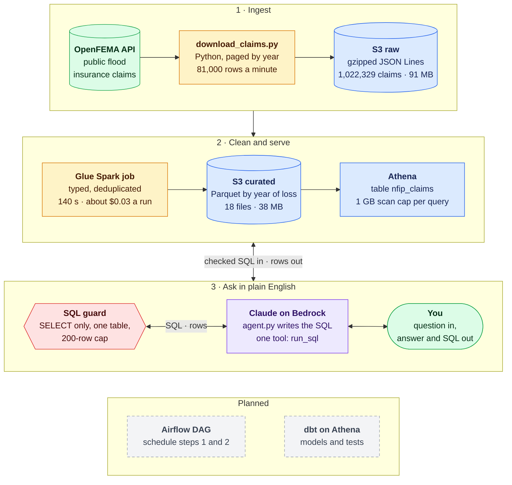
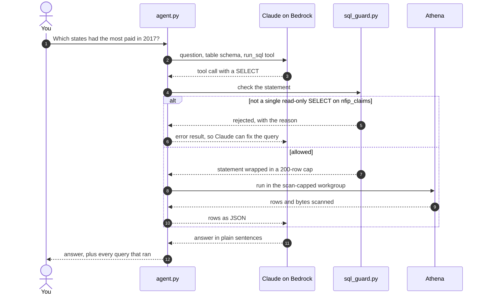

# flood-claims-lakehouse

A small, end-to-end data lakehouse on AWS, built on public flood insurance
claims. It takes about one million claims from FEMA's National Flood Insurance
Program, lands them in S3, cleans them with a Glue Spark job, models them with
dbt on Athena, and runs the whole thing from one Airflow DAG. On top sits a
question assistant: ask in plain English, and Claude on Amazon Bedrock writes
the SQL, runs it on Athena and answers with the figures.

This is a personal project. I built it to show how I put a pipeline together
on AWS: infrastructure as code, tested transformations, data quality checks
that stop a bad load, and a cost limit on every piece.

## Architecture



Green is what goes in and comes out, amber is compute, blue is storage and
query, purple is the model, red is the check the model cannot bypass, and
dashed grey is not built yet. The numbers are from the first full run.

The S3 buckets, the Glue job, and the Athena table and workgroup are created by
Terraform (22 resources). GitHub Actions runs the unit tests, `terraform fmt`
and `terraform validate` on every push.

## Status

| Part | State |
|---|---|
| Ingest from the OpenFEMA API | Working. Full load run into S3 |
| Cleaning rules (`glue_jobs/transforms.py`) | Working. Unit tested and run on the full dataset |
| Terraform for S3, Glue and Athena | Working. Applied; 22 resources |
| Glue job run on AWS | Working. Full dataset cleaned to Parquet |
| Athena table over the curated data | Working. Row counts checked against the source |
| Question assistant (Claude on Bedrock, text to SQL) | Working. 10 of 10 on the evaluation set |
| Lake Formation permissions | Planned |
| dbt models and tests on Athena | Planned |
| Airflow DAG | Planned |

I update this table as each part is finished. Nothing is marked working until
I have run it.

## Measured results

First full run, 15 November 2026, region us-east-2.

| Step | Result |
|---|---|
| Ingest | 1,022,329 claims in 755 seconds (about 81,000 rows a minute), 112 files, 91 MB gzipped |
| Glue job | 140 seconds on 2 workers, 281 DPU-seconds, about $0.03 at $0.44 per DPU-hour |
| Curated output | 18 Parquet files, 38 MB, one partition per year of loss |
| Athena: count and date range over all rows | 0.7 seconds, 12.8 MB scanned |
| Athena: claims and total paid by state | 0.5 seconds, 5.9 MB scanned |

Checks on the output: 1,022,329 rows and 1,022,329 distinct claim ids, the
same count the API reports; years of loss 2009 to 2026; $52.7 billion paid in
total.

The first Glue run failed. A small number of claims carry a placeholder
construction date centuries in the past, which Spark will not write to Parquet.
The fix is a cleaning rule that turns any date before 1800 into null, with a
unit test for it.

## Ask the data in plain English

```bash
python -m ai.ask "Which three states had the highest total claims paid in 2017?"
```

Claude gets the table's schema and a single tool, `run_sql`. It writes a
query, the code checks and runs it, and Claude reads the rows and answers. The
answer comes back with every query that produced it, so the work can be
checked.



The model is not trusted to behave. `ai/sql_guard.py` checks each statement
before it reaches Athena:

- one statement only, and it must be a SELECT
- no write or admin keywords (insert, drop, alter and so on)
- only the claims table may be read
- results are capped at 200 rows

The Athena workgroup adds its own cap of 1 GB scanned per query, and the agent
stops after six queries per question. The guard has 15 unit tests.

### Evaluation

`python -m ai.eval` asks ten questions. Each has a hand-written SQL statement
that returns the true answer, and the agent passes a question when that value
appears in its reply (numbers within 0.5%).

| Run of 15 November 2026 | |
|---|---|
| Model | Claude Sonnet 4.6 on Amazon Bedrock |
| Passed | 10 of 10 |
| Queries run | 10, one per question |
| Tokens | 27,315 input, 1,342 output: about $0.10 at $3 and $15 per million |
| Athena | 26.9 MB scanned in total |

The questions, answers and queries are in `ai/eval_results.json`.

What this does and does not show: the ten questions are single-table
aggregations, the kind this table is good for, and I wrote them. It shows the
loop and the guard work and that the schema description is enough for the model
to write correct SQL. It is not a benchmark. Three further checks by hand
behaved as intended: asked what a FEMA code means, it gave the count and said
it does not have the code's meaning; asked to delete rows, it declined; asked
for Miami home prices, it said the table does not hold that.

The first trial answer added hurricane names from the model's own knowledge.
The prompt now tells it to report only what its queries returned.

## The data

[OpenFEMA NFIP Redacted Claims, version 3](https://www.fema.gov/openfema-data-page/nfip-redacted-claims-v3):
one row per flood insurance claim, 84 fields. As of FEMA's refresh on 15
November 2026 it holds 1,022,329 claims with a date of loss from 2009 onward.
FEMA redacts it for privacy, so there are no names or street addresses.
It is public data published by FEMA. FEMA and the federal government do not
vouch for this project or for any analysis made from the data.

## Run it locally

Requires Python 3.11 and Java 17.

```bash
python -m venv .venv
source .venv/bin/activate          # Windows: .venv\Scripts\activate
pip install -r requirements.txt

# Download one year of claims, about 85,000 rows for 2016
python ingest/download_claims.py --out data/raw --years 2016

# Clean it into partitioned Parquet
python glue_jobs/clean_claims.py \
    --raw_path data/raw/nfip_claims \
    --curated_path data/curated/nfip_claims

pytest -q tests
```

The question assistant needs AWS credentials and access to an Anthropic model
on Bedrock. Set `BEDROCK_MODEL_ID` to use a model other than the default.

On Windows, Spark needs a `winutils.exe` and `hadoop.dll` that match its
Hadoop version before it can read and write local files. The tests do not
touch the file system and run without them.

## Deploy to AWS

```bash
cd terraform
terraform init
terraform apply

python ingest/download_claims.py --out s3://<raw_bucket>/raw --years 1970-2026
aws glue start-job-run --job-name flood-claims-lakehouse-clean-claims

scripts/athena_query.sh "select state, count(*) from flood_claims_lakehouse_curated.nfip_claims group by 1"
```

Credentials come from your AWS CLI profile or environment variables. None are
stored in this repository.

## Cost controls

- The Glue job runs on 2 workers, the minimum, with a 30-minute timeout.
- The Athena workgroup stops any query that would scan more than 1 GB.
- Query results are deleted after 7 days.
- Every bucket blocks public access and is encrypted.
- `terraform destroy` removes everything, including the data.

## Design choices

- **One folder per year of loss in raw.** A failed download or a corrected year
  can be reloaded on its own, and the Glue job overwrites only the partitions
  it was given.
- **Cleaning rules live apart from the Glue entry point.** `transforms.py` has
  no Glue imports, so the same code runs in a local Spark session and in CI.
- **A missing source field fails the job.** If FEMA renames or drops a field,
  the run stops with the field name, instead of writing a column of nulls.
- **Partition projection on the Athena table.** Athena works out the year
  folders from a rule, so a new year of data needs no crawler and no repair
  command.
- **Duplicates resolve to the latest `asOfDate`.** FEMA republishes claims as
  they are updated; the newest version of a claim wins.

## License

MIT. See [LICENSE](LICENSE).
