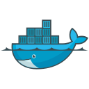
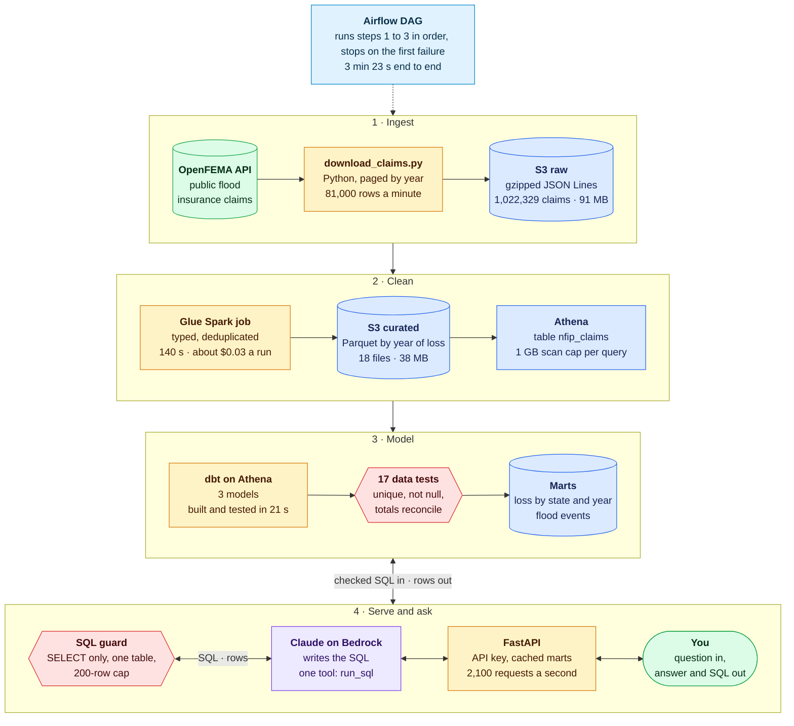
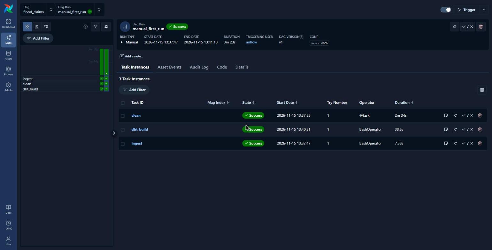
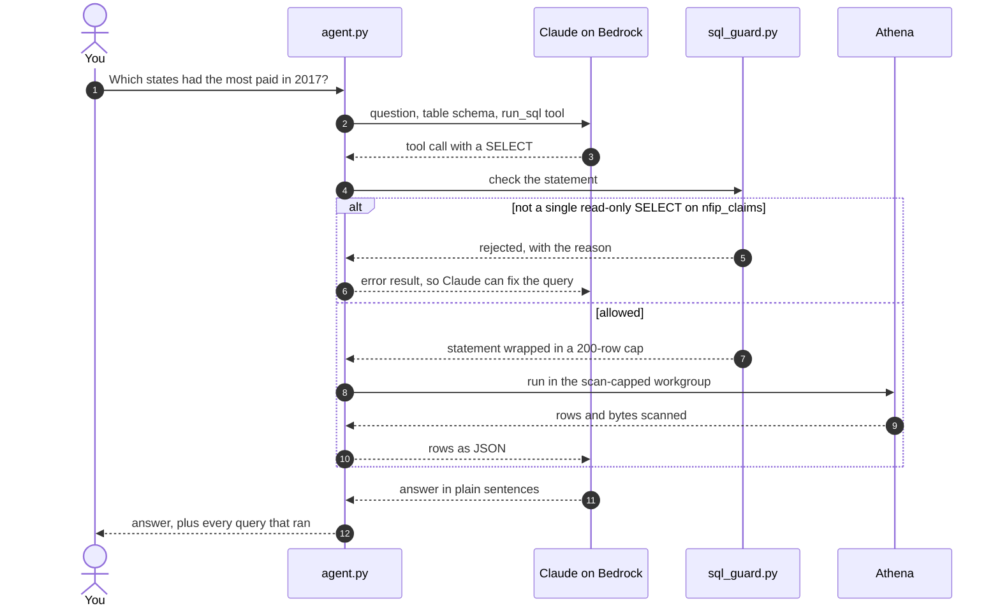

# flood-claims-lakehouse

A small, end-to-end data lakehouse on AWS, built on public flood insurance
claims. It takes about one million claims from FEMA's National Flood Insurance
Program, lands them in S3, cleans them with a Glue Spark job, models them with
dbt on Athena, and runs the whole thing from one Airflow DAG. On top sits a
question assistant: ask in plain English, and Claude on Amazon Bedrock writes
the SQL, runs it on Athena and answers with the figures. A small FastAPI
service puts the marts and the assistant behind an API key.

This is a personal project. I built it to show how I put a pipeline together
on AWS: infrastructure as code, tested transformations, data quality checks
that stop a bad load, and a cost limit on every piece.

## Tech stack

<table>
  <tr>
    <td align="center" width="110"><br><sub>Python</sub></td>
    <td align="center" width="110"><br><sub>Apache Spark</sub></td>
    <td align="center" width="110"><br><sub>Amazon S3</sub></td>
    <td align="center" width="110"><br><sub>AWS Glue</sub></td>
    <td align="center" width="110"><br><sub>Amazon Athena</sub></td>
    <td align="center" width="110"><br><sub>dbt</sub></td>
    <td align="center" width="110"><br><sub>Apache Airflow</sub></td>
  </tr>
  <tr>
    <td align="center" width="110"><br><sub>FastAPI</sub></td>
    <td align="center" width="110"><br><sub>Amazon Bedrock</sub></td>
    <td align="center" width="110"><br><sub>Claude</sub></td>
    <td align="center" width="110"><br><sub>Terraform</sub></td>
    <td align="center" width="110"><br><sub>Docker</sub></td>
    <td align="center" width="110"><br><sub>GitHub Actions</sub></td>
    <td align="center" width="110"><br><sub>pytest</sub></td>
  </tr>
</table>

| Layer | Tools |
|---|---|
| Ingest | Python, the OpenFEMA API |
| Storage | Amazon S3: gzipped JSON Lines raw, Parquet curated |
| Processing | AWS Glue running Apache Spark (PySpark) |
| Query and modelling | Amazon Athena, dbt with 17 data tests |
| Orchestration | Apache Airflow 3, in Docker |
| Serving | FastAPI, with an API key and a cache |
| AI | Claude on Amazon Bedrock, behind a SQL guard |
| Infrastructure and checks | Terraform, GitHub Actions, pytest |

## Architecture



Green is what goes in and comes out, amber is compute, blue is storage and
query, purple is the model, and red marks the checks: the data tests a load
must pass and the guard the model cannot bypass. Every number is measured.

The S3 buckets, the Glue job, and the Athena table and workgroup are created by
Terraform (22 resources). GitHub Actions runs the unit tests, `terraform fmt`
and `terraform validate` on every push.

## Status

| Part | State |
|---|---|
| Ingest from the OpenFEMA API | Working. Full load run into S3 |
| Cleaning rules (`glue_jobs/transforms.py`) | Working. Unit tested and run on the full dataset |
| Terraform for S3, Glue and Athena | Working. Applied; 22 resources |
| Glue job run on AWS | Working. Full dataset cleaned to Parquet |
| Athena table over the curated data | Working. Row counts checked against the source |
| Question assistant (Claude on Bedrock, text to SQL) | Working. 10 of 10 on the evaluation set |
| dbt models and tests on Athena | Working. 3 models and 17 data tests, all passing |
| Airflow DAG | Working. Two full runs, both succeeded |
| FastAPI service | Working. 13 tests, run against live data, load tested |
| Lake Formation permissions | Planned |

I update this table as each part is finished. Nothing is marked working until
I have run it.

## Measured results

First full run, 15 November 2026, region us-east-2.

| Step | Result |
|---|---|
| Ingest | 1,022,329 claims in 755 seconds (about 81,000 rows a minute), 112 files, 91 MB gzipped |
| Glue job | 140 seconds on 2 workers, 281 DPU-seconds, about $0.03 at $0.44 per DPU-hour |
| Curated output | 18 Parquet files, 38 MB, one partition per year of loss |
| Athena: count and date range over all rows | 0.7 seconds, 12.8 MB scanned |
| Athena: claims and total paid by state | 0.5 seconds, 5.9 MB scanned |
| dbt build | 3 models and 17 data tests in 21 seconds |
| Airflow run, one year reloaded | 3 min 23 s: ingest 7 s, Glue job 2 min 34 s, dbt 39 s |
| API, cached route | about 2,100 requests a second, p99 26 ms, no errors |

Checks on the output: 1,022,329 rows and 1,022,329 distinct claim ids, the
same count the API reports; years of loss 2009 to 2026; $52.7 billion paid in
total.

The first Glue run failed. A small number of claims carry a placeholder
construction date centuries in the past, which Spark will not write to Parquet.
The fix is a cleaning rule that turns any date before 1800 into null, with a
unit test for it.

## Models and data tests (dbt)

`dbt/` holds three models, built on Athena:

| Model | Kind | What it is |
|---|---|---|
| `stg_claims` | view | One row per claim, with a paid flag, total damage and damage ratio |
| `mart_loss_by_state_year` | table | Claims, share paid, total and median paid, by state and year (967 rows) |
| `mart_flood_events` | table | Claims, states affected and total paid for each named flood event (126 rows) |

Seventeen data tests run with every build. Most are the standard ones: claim
ids are unique and present, keys are never null. Three are written for this
data: the state and year mart must add up to the staging model in both claims
and dollars, the share paid must be between 0 and 1, and a state and year may
appear only once.

```bash
export CURATED_BUCKET=<curated_bucket> ATHENA_RESULTS_BUCKET=<athena_results_bucket>
dbt build --project-dir dbt --profiles-dir dbt
```

## Orchestration (Airflow)

One DAG, `flood_claims`, runs ingest, the Glue job and `dbt build` in order.
If a step fails the later ones do not run, so a failed load or a failed data
test never reaches the marts. The years to reload are a run parameter.



```bash
scripts/make_env.sh        # writes .env with temporary AWS credentials and bucket names
docker compose up -d       # Airflow 3 at http://127.0.0.1:8080
```

Airflow runs locally in Docker. dbt is installed in its own virtual
environment inside the image, so its dependencies cannot clash with Airflow's.
The Glue step starts the job with boto3 and polls until it ends. The DAG is
set to run monthly; on AWS the same file would run on MWAA, which this project
does not use because it has a fixed monthly cost.

## HTTP API (FastAPI)

| Route | Returns |
|---|---|
| `GET /health` | status; no key needed |
| `GET /claims/by-state?year=2017` | claims and dollars for each state in one year |
| `GET /claims/events?limit=10` | the largest named flood events by amount paid |
| `POST /ask` | a plain-English question answered by the assistant, with its SQL |

```bash
API_KEY=change-me uvicorn api.main:app
curl -H "X-API-Key: change-me" "http://127.0.0.1:8000/claims/by-state?year=2017"
```

- Every route except `/health` needs the `X-API-Key` header. Started without
  a key configured, the API refuses every request instead of running open.
- Inputs are typed and bounded. A year that is not an integer from 2009 on
  never reaches Athena.
- Mart queries are cached for five minutes; the marts change once a month.
- An Athena failure comes back as a 502 with the reason, not a 500.
- `api/Dockerfile` builds a 170 MB image that runs as an unprivileged user.

### Load test

`scripts/load_test.py`, one uvicorn worker, a 12-thread Intel Core i5-12400
machine running Windows 11, the cached `/claims/by-state` route, 20,000
requests per run:

| Generators x connections | Requests a second | Median | p99 | Errors |
|---|---|---|---|---|
| 1 x 10 | 670 | 8.7 ms | 128 ms | 0 |
| 2 x 10 | 1,378 | 9.5 ms | 103 ms | 0 |
| 4 x 10 | 2,103 | 19.9 ms | 26 ms | 0 |
| 8 x 10 | 1,705 | 47.1 ms | 60 ms | 0 |

The first run looked wrong: 636 requests a second at 10 connections, falling
to 353 at 200. The health route, which does no work, fell the same way, so the
route was not the cause. Running two generators side by side doubled the
total, which showed the limit was the load generator, a single Python process,
not the API. The script now runs several generators and adds their rates. One
worker peaks at about 2,100 requests a second and drops past that as it
saturates.

What the number covers: a cached route on one machine, with the generator on
the same machine. A cache miss waits on an Athena query, and `/ask`
waits on the model and on Athena. Those are bounded by AWS, not by this
service.

## Ask the data in plain English

```bash
python -m ai.ask "Which three states had the highest total claims paid in 2017?"
```

Claude gets the table's schema and a single tool, `run_sql`. It writes a
query, the code checks and runs it, and Claude reads the rows and answers. The
answer comes back with every query that produced it, so the work can be
checked.



The model is not trusted to behave. `ai/sql_guard.py` checks each statement
before it reaches Athena:

- one statement only, and it must be a SELECT
- no write or admin keywords (insert, drop, alter and so on)
- only the claims table may be read
- results are capped at 200 rows

The Athena workgroup adds its own cap of 1 GB scanned per query, and the agent
stops after six queries per question. The guard has 15 unit tests.

### Evaluation

`python -m ai.eval` asks ten questions. Each has a hand-written SQL statement
that returns the true answer, and the agent passes a question when that value
appears in its reply (numbers within 0.5%).

| Run of 15 November 2026 | |
|---|---|
| Model | Claude Sonnet 4.6 on Amazon Bedrock |
| Passed | 10 of 10 |
| Queries run | 10, one per question |
| Tokens | 27,315 input, 1,342 output: about $0.10 at $3 and $15 per million |
| Athena | 26.9 MB scanned in total |

The questions, answers and queries are in `ai/eval_results.json`.

What this does and does not show: the ten questions are single-table
aggregations, the kind this table is good for, and I wrote them. It shows the
loop and the guard work and that the schema description is enough for the model
to write correct SQL. It is not a benchmark. Three further checks by hand
behaved as intended: asked what a FEMA code means, it gave the count and said
it does not have the code's meaning; asked to delete rows, it declined; asked
for Miami home prices, it said the table does not hold that.

The first trial answer added hurricane names from the model's own knowledge.
The prompt now tells it to report only what its queries returned.

## The data

[OpenFEMA NFIP Redacted Claims, version 3](https://www.fema.gov/openfema-data-page/nfip-redacted-claims-v3):
one row per flood insurance claim, 84 fields. As of FEMA's refresh on 15
November 2026 it holds 1,022,329 claims with a date of loss from 2009 onward.
FEMA redacts it for privacy, so there are no names or street addresses.
It is public data published by FEMA. FEMA and the federal government do not
vouch for this project or for any analysis made from the data.

## Run it locally

Requires Python 3.11 and Java 17.

```bash
python -m venv .venv
source .venv/bin/activate          # Windows: .venv\Scripts\activate
pip install -r requirements.txt

# Download one year of claims, about 85,000 rows for 2016
python ingest/download_claims.py --out data/raw --years 2016

# Clean it into partitioned Parquet
python glue_jobs/clean_claims.py \
    --raw_path data/raw/nfip_claims \
    --curated_path data/curated/nfip_claims

pytest -q tests
```

The question assistant needs AWS credentials and access to an Anthropic model
on Bedrock. Set `BEDROCK_MODEL_ID` to use a model other than the default.
dbt runs from its own environment: `pip install dbt-core dbt-athena`.

On Windows, Spark needs a `winutils.exe` and `hadoop.dll` that match its
Hadoop version before it can read and write local files. The tests do not
touch the file system and run without them.

## Deploy to AWS

```bash
cd terraform
terraform init
terraform apply

python ingest/download_claims.py --out s3://<raw_bucket>/raw --years 1970-2026
aws glue start-job-run --job-name flood-claims-lakehouse-clean-claims

scripts/athena_query.sh "select state, count(*) from flood_claims_lakehouse_curated.nfip_claims group by 1"
```

Credentials come from your AWS CLI profile or environment variables. None are
stored in this repository.

## Cost controls

- The Glue job runs on 2 workers, the minimum, with a 30-minute timeout.
- The Athena workgroup stops any query that would scan more than 1 GB.
- Query results are deleted after 7 days.
- Every bucket blocks public access and is encrypted.
- `terraform destroy` removes everything, including the data.

## Design choices

- **One folder per year of loss in raw.** A failed download or a corrected year
  can be reloaded on its own, and the Glue job overwrites only the partitions
  it was given.
- **Cleaning rules live apart from the Glue entry point.** `transforms.py` has
  no Glue imports, so the same code runs in a local Spark session and in CI.
- **A missing source field fails the job.** If FEMA renames or drops a field,
  the run stops with the field name, instead of writing a column of nulls.
- **Partition projection on the Athena table.** Athena works out the year
  folders from a rule, so a new year of data needs no crawler and no repair
  command.
- **The marts must reconcile.** A dbt test compares the mart's claims and
  dollars with the staging model on every build; a join or filter that drops
  rows fails the run.
- **Duplicates resolve to the latest `asOfDate`.** FEMA republishes claims as
  they are updated; the newest version of a claim wins.

## License

MIT. See [LICENSE](LICENSE).
